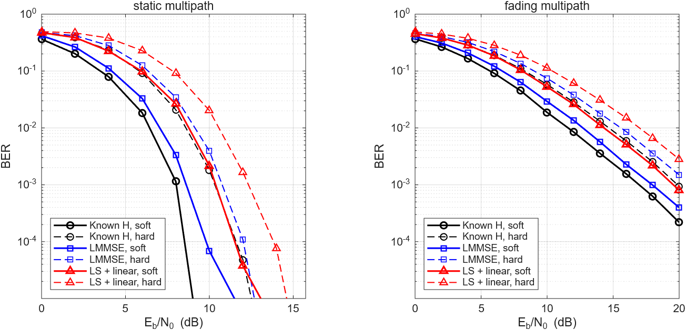

# OFDM 链路仿真与 C++ Viterbi 译码器

这个项目包含两部分：

- **MATLAB 链路仿真：** 64 子载波 QPSK OFDM，比较理想信道、LMMSE 和 LS 信道估计，以及软硬判决 Viterbi 译码。
- **C++17 译码器：** 通用的 1/n 卷积码编码器和滑动窗口 Viterbi 译码器，用 MATLAB `convenc` / `vitdec` 的输出逐比特验证。

## 主要结果

### C++ 译码器

| 项目 | 结果 |
|---|---|
| 与 MATLAB 对照 | 编码器和 11 组噪声向量（5 组硬判决、4 组软判决、2 组真实 OFDM 接收数据）逐比特一致 |
| 单线程吞吐（硬判决 / 软判决） | C++ 8.5 / 6.8 Mbit/s，`vitdec` 2.8 / 1.7 Mbit/s |
| AWGN 下的软判决增益 | BER=10⁻³ 时约 2.0 dB，BER=10⁻⁵ 时约 2.3 dB |

吞吐是同一台电脑上三次运行取最好值，换机器后数字会变。

### OFDM 链路

达到目标 BER 所需的 Eb/N0（dB），取两个随机种子的平均，每点 20000 个 OFDM 符号：

| 接收机 | 静态多径，BER=10⁻³ | 衰落多径，BER=10⁻² |
|---|---|---|
| 理想信道（同样有导频开销） | 硬 10.3 / 软约 8.1 | 硬 14.7 / 软 11.7 |
| LMMSE 估计 | 硬 10.8 / 软 8.7 | 硬 15.5 / 软 12.7 |
| LS + 线性插值 | 硬 12.3 / 软 10.4 | 硬 16.9 / 软 14.3 |

理想信道的静态软判决只取种子 2：种子 1 在 10 dB 已统计不到错误比特，无法插值。



完整数据在 [results](results)。

## 目录结构

```text
include/viterbi.hpp        编码器和译码器接口
src/viterbi.cpp            实现
tests/test_viterbi.cpp     单元测试和 MATLAB 向量对照
tests/vectors/             MATLAB 导出的对照向量
tools/viterbi_bench.cpp    吞吐和 AWGN 误码测试
matlab/ofdm_config.m       链路参数
matlab/ofdm_link_point.m   单个 Eb/N0 点的收发仿真
matlab/run_ofdm_link.m     扫描 Eb/N0、自检、输出结果和曲线
matlab/generate_vectors.m  导出对照向量并测 vitdec 吞吐
results/                   仿真结果
```

## 运行方法

C++ 部分需要 CMake 和支持 C++17 的编译器。下面是 Windows + MinGW 的命令，其他环境去掉 `-G` 参数即可：

```bash
cmake -S . -B build -G "MinGW Makefiles"
```

```bash
cmake --build build
```

```bash
ctest --test-dir build --output-on-failure
```

```bash
./build/viterbi_bench 5000000
```

MATLAB 部分需要 Communications Toolbox，在 `matlab` 文件夹下运行：

```matlab
seed = 1; run_ofdm_link
generate_vectors
```

## 实现思路

**译码器**

- **状态：** K=7 时有 64 个状态，状态的最高位是最近一个输入比特。
- **加比选（ACS）：** 每个状态有两个前驱，它们只差最低位。分别累加分支度量，保留较小的路径，并记下选了哪个前驱。
- **回溯：** 每一步从当前最优状态回溯 32 步，输出最早的那个比特；输入结束时，从最终最优状态输出剩下的比特。幸存路径放在环形缓冲区里，内存占用与序列长度无关。
- **分支度量：** 硬判决用汉明距离；软判决用与 ±1 的负相关，它和欧氏距离只差所有路径共有的项。
- **度量溢出：** 只有度量之差有意义，所以数值过大时统一减去当前最优值。
- **打平规则：** 路径度量相等时取编号小的前驱，最优状态打平时取编号最大的状态。这个选择不影响平均性能，但决定能否与 `vitdec` 逐比特一致。规则是用 MATLAB 向量试出来的，不是官方文档给出的。

**接收机**

- **导频：** 64 个子载波中取 16 个做梳状导频，间隔 4，最多能分辨 16 径，这里的信道只有 3 径。
- **LS：** 导频处直接用接收值除以导频，再在频域线性插值。不需要信道统计信息，但噪声没有被充分抑制。
- **LMMSE：** 利用子载波之间的相关性在导频间滤除噪声，因此 NMSE 更低。
- **软判决输入：** 零迫之后噪声随 1/|H|² 变化，所以用 |H|² 加权，让深衰落子载波的判决置信度变低。

## 自检

`run_ofdm_link.m` 在跑全量之前会先确认：

1. 几乎无噪声时，LS 导频处估计等于真实信道，所有接收机都没有错误比特。
2. 两种信道下，LS 导频处的 NMSE 与理论值 1/SNR 相差不超过 0.5 dB。
3. 低 SNR 时，LMMSE 明显优于 LS。
4. 软判决的 BER 低于硬判决。

## 已知局限

- **LMMSE 是理想条件：** 仿真假设功率时延分布和噪声功率都已知，实际系统要估计它们，所以 0.5 dB 左右的损失偏乐观。
- **静态信道的 LMMSE：** 相关矩阵用抽头功率近似，忽略了确定性抽头之间的相位关系。
- **衰落信道下降仍然较慢：** 每个 OFDM 符号独立衰落，也没有交织。软判决带来约 3 dB 增益，但没有根本改变曲线斜率。
- **吞吐还有优化空间：** 目前每步都做完整回溯，也没有用 SIMD。这样写是为了能和 `vitdec` 逐比特对照。
